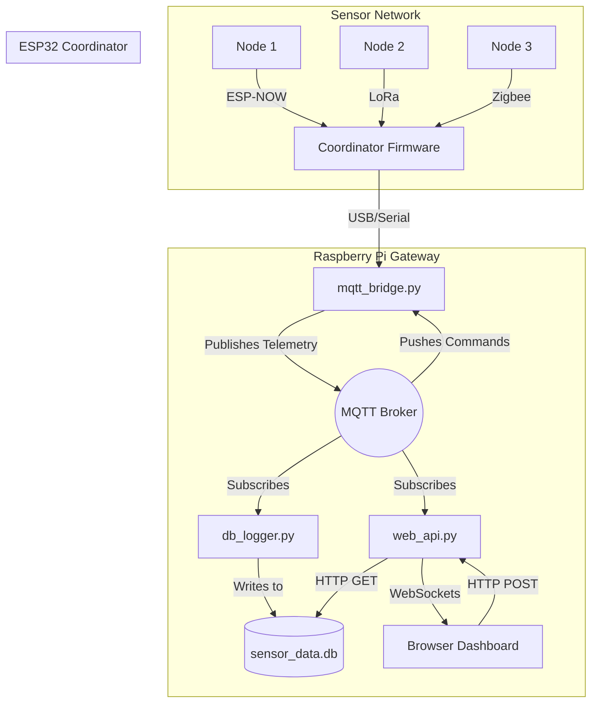

# Raspberry Pi WSN Gateway Documentation

Welcome to the comprehensive technical documentation for the Raspberry Pi Wireless Sensor Network (WSN) Gateway. This guide explains the architecture, data flow, and codebase responsible for bridging low-power microcontrollers (ESP32) with a high-level Python backend.

## System Architecture

The gateway is composed of three decoupled Python microservices communicating over a local MQTT broker.

## Documentation Sections

To make this guide digestible, it has been split into four distinct sections detailing the lifecycle of data as it moves through the system:

1. **[Architecture & Serial Protocol](./serial_protocol.md)**
   Explains how data is physically packaged into binary C-structs and pushed over the USB serial cable between the ESP32 and the Pi.
   
2. **[The MQTT Bridge](./mqtt_bridge.md)**
   Details the core routing engine (`mqtt_bridge.py`) that parses the binary serial frames, applies math scaling (like battery voltage calculation), and translates between Serial and MQTT.

3. **[Data Persistence](./data_persistence.md)**
   Explains the decoupled SQLite logger (`db_logger.py`) that permanently records network events and telemetry into a database.

4. **[Web API and Startup Pipeline](./web_api_and_startup.md)**
   Covers the modern FastAPI web server (`web_api.py`) providing live WebSocket updates to the dashboard, and the `start_gateway.sh` script that manages the initialization of the entire microservice stack.
